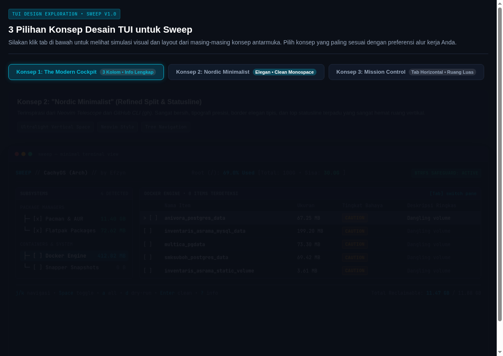

# Sweep 🧹

<p align="center">
  <strong>A modern, modular, cross-distribution Linux system cleaner and maintenance utility.</strong><br>
  Built with Go, Bubbletea, and Lipgloss. Fast, safe-by-default, and keyboard-driven.
</p>

<p align="center">
  <a href="https://golang.org"></a>
  <a href="LICENSE"></a>
  <a href="https://github.com/efzynx/sweep/releases"></a>
  <a href="https://github.com/efzynx/sweep/actions"></a>
</p>

---

## Overview

Unlike legacy Linux cleaners designed primarily for browser cookies and desktop thumbnails, **Sweep** is built for modern developer and power-user workflows. It tackles container bloat (Docker), Copy-on-Write storage snapshots (Btrfs/Snapper), modern packaging layers (Flatpak, Snap), package managers (Pacman, APT, DNF), and heavy developer build caches (Node.js, Go, Cargo, Python).

Sweep features a **Nordic Minimalist** Terminal User Interface (TUI) inspired by *Neovim Telescope* and the *GitHub CLI (`gh`)*, pairing high information density with an ultra-compact vertical footprint.



---

## Key Features

### 1. Dual-Storage Partition Telemetry (`/` and `/home`)
* Automatically detects if `/home` resides on a separate physical disk or partition from the root filesystem (`/`).
* Real-time dual filesystem meters display percentage, used bytes, and free storage remaining for both mounts.
* **Storage Filter (`[p]`):** Cycle cleanup targets between `[TARGET: ALL]`, `[TARGET: ROOT (/) ONLY]`, and `[TARGET: HOME (/home) ONLY]`.
* Table rows clearly badge the target filesystem (`[/]` for Root, `[~]` for Home).

### 2. Comprehensive Subsystem Cleaners
* **Developer Build Caches (`devcache`):**
  * Node.js / JavaScript: `npm` global cache (`~/.npm/_cacache`), `pnpm` virtual store (`~/.local/share/pnpm/store`), and `yarn` cache.
  * Go: compiler and test build cache (`~/.cache/go-build`) and module download cache.
  * Rust / Cargo: crate registry cache (`~/.cargo/registry/cache`) and git database.
  * Python: `pip` HTTP cache and `uv` cache.
* **Package Managers:**
  * Arch / CachyOS: `pacman` package cache pruning, broken download artifacts (`.part`), orphan packages (`pacman -Qtdq`), and AUR clone caches (`paru` / `yay`).
  * Flatpak: unused runtimes (`flatpak list --unused`) and application cache directories (`~/.var/app/*/cache`).
  * Debian / Ubuntu: APT archive cache (`clean` / `autoclean`) and orphan packages (`autoremove`).
  * Fedora / RHEL: DNF cache (`clean all`) and old inactive kernels.
  * openSUSE / SUSE: Zypper package cache (`clean --all`) and unneeded packages (`packages --unneeded`).
  * Snap: disabled and superseded package revisions (`snap list --all`).
* **Containers & Virtualization (`docker`):**
  * Exited / stopped containers.
  * Dangling and unreferenced container images.
  * Unused volume mounts.
  * BuildKit builder caches.
* **Desktop & User Caches (`usercache`):**
  * Desktop Trash Can (`~/.local/share/Trash`).
  * Application thumbnails (`~/.cache/thumbnails`).
  * Browser caches: Mozilla Firefox (`cache2`) and Chromium / Google Chrome (`Default/Cache`).
  * Stale application logs idle for more than 30 days.
* **Filesystems & Snapshots (`snapper`):**
  * Btrfs / Snapper root and home snapshots management.
  * Safe age filtering (> 3 days, > 7 days, > 30 days).
  * Active subvolume (`snapshot #0`) and default boot snapshots are strictly protected against deletion.
* **System Logs (`journal`):**
  * Systemd journal vacuuming via configurable retention rules (`journalctl --vacuum-time=7d`).
* **In-App Custom Paths & Rules (`custom`):**
  * Add custom folders or file patterns directly inside the TUI via interactive modal (`[n]`) without manual YAML editing.

### 3. Safety-First Architecture
* **Read-Only Scanning:** Scans run entirely under standard user credentials without requiring `sudo`.
* **Explicit Dry-Run Simulation:** Test actions with `[d]` or `--dry-run` to inspect exact file paths, counts, and reclaimable bytes before deleting.
* **Pre-Clean Safeguard Snapshot:** Automatically creates a Btrfs pre-clean safeguard snapshot prior to any destructive operation (toggleable via `[t]`).
* **`SUDO_USER` Preservation:** When executed as `sudo sweep`, system-level operations gain root capabilities while user caches and configuration resolve cleanly against the calling user's `$HOME`.

---

## Keyboard Navigation

| Key | Action |
|:---:|:---|
| `Tab` / `Shift+Tab` | Switch focus between Left (Subsystems) and Right (Items) pane |
| `h` / `l` or `←` / `→` | Switch pane focus (Left / Right) |
| `j` / `k` or `↓` / `↑` | Navigate rows vertically |
| `g` / `G` | Jump to top / bottom of list |
| `Space` | Toggle selection for active item or whole subsystem |
| `a` | Select / deselect all items across all modules |
| `p` | Cycle storage partition filter: `ALL` → `ROOT (/)` → `HOME (/home)` |
| `n` | Add a new Custom Path scan rule (when on Custom Paths module) |
| `x` / `Delete` | Remove selected Custom Path rule |
| `s` | Rescan all modules and refresh storage metrics |
| `d` | Open Dry-Run Simulation confirmation modal |
| `Enter` | Open Cleanup Confirmation modal |
| `?` / `i` | Open About & System Information overlay |
| `q` / `Ctrl+C` | Quit Sweep |

---

## Installation & Build

### Requirements
* Linux operating system (Arch/CachyOS, Debian/Ubuntu, Fedora, openSUSE, etc.)
* Go 1.23 or higher

### Building from Source

```bash
# Clone the repository
git clone https://github.com/efzynx/sweep.git
cd sweep

# Build binary
make build

# The compiled binary will be placed at ./bin/sweep
./bin/sweep --version
```

### Running Tests

```bash
# Run unit & integration tests with Go race detector
make test

# Run linter and formatting checks
make lint
```

---

## Usage

```bash
# Launch interactive TUI
./bin/sweep

# Perform read-only scan and print summary report to terminal
./bin/sweep --scan-only

# Simulate cleanup across all detected items without deleting
./bin/sweep --dry-run

# Run with a custom configuration file
./bin/sweep -config /path/to/config.yaml

# Display version details
./bin/sweep --version
```

---

## Configuration

Sweep auto-generates a default configuration file at `~/.config/sweep/config.yaml` on first launch:

```yaml
version: "1.0"

general:
  dry_run_default: true
  snapshot_safeguard: true
  log_level: "info"

modules:
  pacman:
    enabled: true
  docker:
    enabled: true
  flatpak:
    enabled: true
  snapper:
    enabled: true
  devcache:
    enabled: true
  usercache:
    enabled: true
  journal:
    enabled: true
  custom:
    enabled: true

retention:
  snapper_min_age_days: 3
  pacman_keep_versions: 1
  journal_vacuum_days: 7
  dev_cache_idle_days: 30

custom_rules: []
```

---

## Architecture

Sweep follows a decoupled, modular adapter architecture:

```text
┌─────────────────────────────────────────────────────────────┐
│ Presentation Layer: Bubbletea TUI (Nordic Minimalist)       │
│  - Dual-Storage Header Telemetry (/ and /home)              │
│  - Subsystem Category Tree Navigator                        │
│  - Interactive Tabular Item Inspector with Risk Badges      │
│  - In-App Modal Forms (Custom Rules, Dry-Run, About)        │
└──────────────────────────────┬──────────────────────────────┘
                               │
┌──────────────────────────────┴──────────────────────────────┐
│ Core Engine & Registry Layer (internal/core)                │
│  - Concurrent ScanAll() Dispatcher                          │
│  - Storage Detection & Path Classifier (storage.go)         │
│  - Safe-by-Default Selection Manager                        │
│  - Config & Retention Engine (config.go)                    │
└──────────────────────────────┬──────────────────────────────┘
                               │
┌──────────────────────────────┴──────────────────────────────┐
│ Modular Subsystem Adapters (internal/adapters)              │
│  - pacman, docker, flatpak, snapper, devcache, usercache,   │
│    journal, custom, apt, dnf, zypper, snap                  │
└─────────────────────────────────────────────────────────────┘
```

---

## Author & Credits

* **Author:** Ahmad Fauzan Adiman (Efzyn)
* **Website:** [me@efzyn.my.id](mailto:me@efzyn.my.id)
* **GitHub:** [@efzynx](https://github.com/efzynx)

## License

This project is licensed under the [MIT License](LICENSE).
